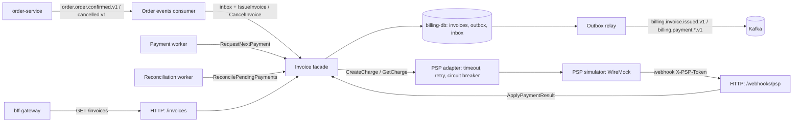

# billing-service Design

**Spec**: `.specs/features/billing-service/spec.md`
**Context**: `.specs/features/billing-service/context.md`
**Status**: Approved (2026-10-24)

---

## Architecture Overview

The billing-service is a Go service with the same hexagonal layout as the other services: a framework-free `core` with ports, and adapters in `infra`. Kafka only feeds invoice issuance; charging happens in a separate worker, so a slow or broken PSP never stalls the consumer.



### Approaches considered for charging

| Approach | Trade-off | Verdict |
| --- | --- | --- |
| **Payment worker + webhook + reconciliation** | PSP outages never block Kafka; retries are per invoice; matches how real PSPs answer (asynchronously). Costs two background loops and an inbound endpoint. | Chosen (ADR-0007) |
| Charge inside the Kafka consumer transaction | One place, fewer parts. A slow PSP stalls the partition and keeps a DB transaction open during HTTP; message retries and charge retries get mixed. | Rejected |
| Synchronous charge plus status polling only | No inbound endpoint. Polling latency and load, and it hides the asynchronous nature of a PSP. | Rejected |

---

## Code Reuse Analysis

There is no Go code in the repository, so reuse is of patterns and contracts, translated to Go.

### Existing Components to Leverage

| Component | Location | How to Use |
| --- | --- | --- |
| Outbox table and relay | `catalog-service/src/infra/persistence/migrations/*outbox*`, `catalog-service/src/infra/messaging/outbox-relay.ts` | Same columns (`sequence`, `event_id`, `aggregate_type`, `aggregate_id`, `event_type`, `payload`, `headers`, `occurred_at`, `published_at`), `FOR UPDATE SKIP LOCKED`, topic = event type, key = aggregate id |
| CloudEvents binary headers | `catalog-service/src/infra/messaging/outbox-relay.ts:119` | `ce_specversion`, `ce_id`, `ce_source`, `ce_type`, `ce_subject`, `ce_time`, `content-type` |
| Dead letter headers | `catalog-service/src/infra/messaging/dead-letter.ts:40` | `dlq-original-topic`, `dlq-original-partition`, `dlq-original-offset`, `dlq-reason` |
| Inbox and retry in place | `compliance-service/src/compliance_service/infra/messaging/product_created_consumer.py` | `processed_events` keyed by `ce_id` inside the unit of work; backoff 1 s doubling to 30 s; DLQ only for messages that can never succeed |
| Order event contracts | `catalog-service/src/infra/messaging/order-stock.consumer.ts:12` | `orderId` is a UUID; `order.order.cancelled.v1` carries `orderId` and an optional `reason` |
| Health with database probe | `order-service/src/infra/http/health/health.routes.ts` | `{"status":"UP"}` or 503 `{"status":"DOWN"}` |
| Problem details | `catalog-service/src/infra/http/error-handler.ts` | Domain error category → status (422/404/409), request shape errors → 400, anything else → 500 without the message |
| Reusable CI | `.github/workflows/_python-service.yml` | Same job names (`build-and-test`, `docker-build`) and `cd` to GHCR on `main`, in a new `_go-service.yml` |

### Integration Points

| System | Integration Method |
| --- | --- |
| order-service | Consumes `order.order.confirmed.v1` and `order.order.cancelled.v1`; order-service consumes `billing.payment.confirmed.v1` and `billing.payment.failed.v1` (#20, #29) |
| bff-gateway | REST `GET /invoices`, `GET /invoices/{id}` (#34) |
| PSP (WireMock) | REST `POST /psp/v1/charges`, `GET /psp/v1/charges/{id}`; webhook back to `POST /webhooks/psp` |
| Postgres | Own database `billing-db` (port 5435) |
| OTel collector | OTLP/HTTP on `OTEL_COLLECTOR_URL` |

---

## Components

Module `github.com/gabezy/arquteitura-multiplataforma-trabalho-final/billing-service`. Tests sit next to the code (`*_test.go`), as in the TypeScript services.

### Composition root

- **Purpose**: Load config, start telemetry, run migrations, wire adapters and run the HTTP server and background loops until the context ends.
- **Location**: `billing-service/cmd/billing-service/main.go` (signals, `healthcheck` subcommand), `billing-service/internal/app/`
- **Interfaces**:
  - `app.Run(ctx context.Context, cfg config.Config, logger *slog.Logger) error` - blocks until `ctx` is cancelled, then shuts down within 10 s
- **Dependencies**: every infra package
- **Reuses**: the role of `main.ts` in the TypeScript services

### Core shared domain

- **Purpose**: Error categories and event recording shared by aggregates.
- **Location**: `billing-service/internal/core/shared/domain/`
- **Interfaces**:
  - `ValidationError`, `NotFoundError`, `ConflictError` (types that wrap a message; `errors.As` finds the category)
  - `AggregateRoot.Record(DomainEvent)`, `AggregateRoot.PullEvents() []DomainEvent`
  - `DomainEvent` interface: `EventName() string`, `AggregateID() string`, `OccurredAt() time.Time`

### Invoice model

- **Purpose**: The `Invoice` aggregate and its value objects.
- **Location**: `billing-service/internal/core/invoice/model/`
- **Interfaces**:
  - `NewMoney(cents int64) (Money, error)`; `Money.Cents()`, `Add`, `Times(qty)`, `Sub`
  - `ParseMarketplace(string) (Marketplace, error)`: `AMAZON`, `MERCADO_LIVRE`, `SHOPEE`
  - `NewItem(sku string, quantity int, unitPrice Money) (Item, error)` (bounds from the spec)
  - `CommissionPolicy` interface: `RateBps() int`, `Commission(total Money) Money`; `PercentageCommission{rateBps}`; `CommissionPolicies.For(Marketplace) (CommissionPolicy, error)`
  - `IssueInvoice(id, order OrderData, policy CommissionPolicy, now time.Time) (*Invoice, error)` records `InvoiceIssued`
  - `(*Invoice).Cancel(reason string, now time.Time) (changed bool)`
  - Payment (#32): `MarkPaymentPending(chargeID, now)`, `ConfirmPayment(chargeID, paidAt)`, `FailPayment(chargeID, reason, failedAt)`, `PaymentAttemptFailed(now)`; the confirm and fail methods return `(changed bool, err error)`, with `ConflictError` for a contradiction
  - `(*Invoice).Snapshot() Snapshot`, `Restore(Snapshot) *Invoice`
- **Status machine**:

| From | Event | To |
| --- | --- | --- |
| (new) | order confirmed | `ISSUED` |
| `ISSUED` | PSP accepted the charge | `PAYMENT_PENDING` |
| `ISSUED`, `PAYMENT_PENDING` | PSP reports paid | `PAID` |
| `ISSUED`, `PAYMENT_PENDING` | PSP refuses or reports failure | `PAYMENT_FAILED` |
| `ISSUED`, `PAYMENT_PENDING` | order cancelled | `CANCELLED` |
| `PAID`, `PAYMENT_FAILED`, `CANCELLED` | same outcome again | unchanged, no event |
| `PAID`, `PAYMENT_FAILED`, `CANCELLED` | order cancelled | unchanged, no event |
| any final | contradicting payment outcome | `ConflictError` |

- **Rounding**: `commission = (total × bps + 5000) / 10000` in integer cents (half-up for positive amounts).

### Invoice facade

- **Purpose**: Use cases; implements `port/in` and depends only on `port/out`.
- **Location**: `billing-service/internal/core/invoice/facade.go`, ports in `port/in/` and `port/out/`
- **Interfaces** (`port/in`):
  - `IssueInvoice(ctx, IssueInvoiceCommand) (IssueOutcome, error)`: `Issued`, `AlreadyIssued` or `OrderCancelled`
  - `CancelInvoice(ctx, CancelInvoiceCommand) (CancelOutcome, error)`: `Cancelled`, `Unchanged` or `Recorded`
  - `GetInvoice(ctx, id string) (model.Snapshot, error)`; `ListInvoices(ctx, InvoiceQuery) ([]model.Snapshot, error)`
  - #32: `RequestNextPayment(ctx) (processed bool, err error)`, `ApplyPaymentResult(ctx, PaymentResult) (changed bool, err error)`, `ReconcilePendingPayments(ctx) (int, error)`
- **Dependencies** (`port/out`): `InvoiceRepository`, `OrderCancellations`, `Transactor`, `IDGenerator`, `Clock`, `CommissionPolicies`, and #32 `PaymentGateway`
- **Transactions**: `Transactor.WithinTransaction(ctx, fn)` puts the transaction in the context; repositories use it when present, and a nested call joins the outer transaction. The consumer's inbox insert and the facade's writes therefore share one commit.

### Persistence

- **Purpose**: pgx pool, transactor, migrations, repositories.
- **Location**: `billing-service/internal/infra/persistence/`
- **Interfaces**:
  - `Open(ctx, url) (*pgxpool.Pool, error)` with the otelpgx tracer
  - `Migrate(ctx, url) error`: goose provider over embedded `migrations/*.sql`, Postgres session advisory lock
  - `Transactor`, `InvoiceRepository` (save = insert/update with `version`, plus the pulled events into the outbox), `OrderCancellations`, `Inbox.MarkProcessed(ctx, eventID, eventType) (first bool, err error)`
  - #32: `LockNextDue(ctx, now)` with `FOR UPDATE SKIP LOCKED`, `LockByID(ctx, id)` with `FOR UPDATE`, `ListPendingRequestedBefore(ctx, t, limit)`

### Outbox

- **Purpose**: Store integration events in the caller's transaction and publish them.
- **Location**: `billing-service/internal/infra/outbox/`
- **Interfaces**:
  - `Store.Append(ctx, events []domain.DomainEvent) error`: maps each event with `Mapper`, saves the W3C trace context in `headers`; an unmapped event fails the transaction
  - `Relay.Run(ctx)`: every `OUTBOX_POLL_INTERVAL`, locks up to 100 pending rows (`SKIP LOCKED`), produces them in `sequence` order and marks `published_at` in the same transaction
  - `Producer` interface (`ProduceSync`), implemented by the franz-go client

### Messaging

- **Purpose**: Kafka client, CloudEvents translation, order events consumer, dead letter, integration event mapping.
- **Location**: `billing-service/internal/infra/messaging/`
- **Interfaces**:
  - `NewClient(cfg, tracer)`: franz-go client with the kotel hooks, manual commits, consumer group `billing-service`
  - `OrderEventsConsumer.Run(ctx)`: per record, parse → DLQ if it can never succeed → transaction (inbox + facade) with retry 1 s..30 s → commit offset
  - `ToIntegrationEvent(domain.DomainEvent) (eventType string, data any, err error)`

### HTTP

- **Purpose**: Health, invoice queries, PSP webhook, problem details.
- **Location**: `billing-service/internal/infra/httpapi/`
- **Interfaces**: `NewServer(cfg, deps) *http.Server` with `net/http` patterns (`GET /health`, `GET /invoices`, `GET /invoices/{id}`, `POST /webhooks/psp`), wrapped by `otelhttp`

### PSP adapter

- **Purpose**: Implement `PaymentGateway` against the PSP API with timeout, retry and circuit breaker.
- **Location**: `billing-service/internal/infra/psp/`
- **Interfaces**: `CreateCharge(ctx, ChargeRequest) (ChargeResult, error)`, `GetCharge(ctx, chargeID) (ChargeStatus, error)`; errors split into refused (422), unavailable (timeout, connection, 5xx, 429, open circuit) and unexpected
- **Resilience**: retry loop outside, `gobreaker.CircuitBreaker` inside around each attempt; an open circuit is not retried

### Workers

- **Purpose**: Background loops for charging and reconciliation.
- **Location**: `billing-service/internal/infra/worker/`
- **Interfaces**: `PaymentWorker.Run(ctx)` (every 2 s, drains due invoices one by one until none is due or the PSP is unavailable); `ReconciliationWorker.Run(ctx)` (every 30 s)

---

## Data Models

### Tables

```sql
-- 0001 (bootstrap)
outbox(sequence bigserial pk, event_id uuid unique, aggregate_type text, aggregate_id uuid,
       event_type text, payload jsonb, headers jsonb, occurred_at timestamptz, published_at timestamptz)
processed_events(event_id text pk, event_type text, processed_at timestamptz)

-- 0002 (#23)
invoices(id uuid pk, order_id uuid unique, external_order_id text, marketplace text,
         total_cents bigint, commission_rate_bps int, commission_cents bigint, net_cents bigint,
         status text, issued_at timestamptz, cancelled_at timestamptz, cancellation_reason text,
         updated_at timestamptz, version int)
invoice_items(invoice_id uuid fk, line smallint, sku text, quantity int, unit_price_cents bigint, pk(invoice_id, line))
order_cancellations(order_id uuid pk, reason text, cancelled_at timestamptz)

-- 0003 (#32, expand only)
invoices + psp_transaction_id text (unique when not null), failure_reason text, payment_attempts int default 0,
           next_payment_attempt_at timestamptz, payment_requested_at timestamptz, paid_at timestamptz, failed_at timestamptz
```

An `ISSUED` invoice with a null `next_payment_attempt_at` is due immediately.

### Consumed events (defined in the event catalog of #8, `docs/eventos.md`)

`order.order.confirmed.v1`, key `orderId`:

```json
{
  "orderId": "6f1c2b8e-0000-4000-8000-000000000001",
  "marketplace": "MERCADO_LIVRE",
  "externalOrderId": "ML-2000001",
  "items": [{ "sku": "231", "quantity": 1, "unitPrice": 15000.00 }],
  "total": 15000.00,
  "confirmedAt": "2026-10-24T12:00:00Z"
}
```

`order.order.cancelled.v1`: `{"orderId": "...", "reason": "PAYMENT_FAILED"}` (contract already used by the catalog).

### Published events (key `invoiceId`)

```json
// billing.invoice.issued.v1
{ "invoiceId": "...", "orderId": "...", "externalOrderId": "ML-2000001", "marketplace": "MERCADO_LIVRE",
  "amount": 15000.00, "commissionPercent": 11.00, "commissionAmount": 1650.00,
  "netAmount": 13350.00, "issuedAt": "2026-10-24T12:00:01Z" }
// billing.payment.confirmed.v1
{ "invoiceId": "...", "orderId": "...", "amount": 15000.00, "pspTransactionId": "ch_paid_...", "paidAt": "..." }
// billing.payment.failed.v1
{ "invoiceId": "...", "orderId": "...", "amount": 105000.00, "pspTransactionId": "ch_failed_...",
  "reason": "INSUFFICIENT_FUNDS", "failedAt": "..." }
```

Money goes out as JSON numbers with exactly two decimals, written from integer cents (`json.Number`), so no float ever touches an amount.

### PSP API (simulated)

```http
POST /psp/v1/charges
Idempotency-Key: <invoiceId>
{"reference": "<invoiceId>", "amount": 1500000, "currency": "BRL",
 "description": "Pedido <orderId> (MERCADO_LIVRE)", "callbackUrl": "http://billing-service:8086/webhooks/psp"}
→ 201 {"id": "ch_paid_<invoiceId>", "reference": "<invoiceId>", "status": "PENDING"}
→ 422 {"code": "<reason>"} refused on creation

POST <callbackUrl>   (WireMock webhook, 2 s later)
X-PSP-Token: <PSP_WEBHOOK_TOKEN>
{"chargeId": "ch_paid_<invoiceId>", "reference": "<invoiceId>", "status": "PAID", "failureReason": null, "occurredAt": "..."}

GET /psp/v1/charges/{id} → 200 {"id": "...", "reference": "...", "status": "PENDING|PAID|FAILED", "failureReason": null}
```

The amount is in cents, as PSPs usually expect. The simulator is stateless, so it encodes the outcome in the charge id (`ch_paid_…`, `ch_failed_…`) to answer the status query; billing treats the id as opaque.

### REST API

```json
// GET /invoices/{id} → 200
{ "id": "...", "orderId": "...", "externalOrderId": "ML-2000001", "marketplace": "MERCADO_LIVRE",
  "status": "PAID", "amount": 15000.00, "commissionPercent": 11.00,
  "commissionAmount": 1650.00, "netAmount": 13350.00,
  "items": [{ "sku": "231", "quantity": 1, "unitPrice": 15000.00, "amount": 15000.00 }],
  "issuedAt": "...", "cancelledAt": null, "cancellationReason": null,
  "pspTransactionId": "ch_paid_...", "failureReason": null, "paidAt": "...", "failedAt": null }
// GET /invoices?orderId=&status=&marketplace=&limit=20&offset=0 → 200
{ "invoices": [ ... ], "limit": 20, "offset": 0 }
```

---

## Error Handling Strategy

| Error Scenario | Handling | User Impact |
| --- | --- | --- |
| Message without required `ce_*` header, invalid JSON, contract violation | Dead letter with `dlq-*` headers, commit offset | Message visible in `billing.order-events.dlq` (14 days) |
| `ValidationError` raised by the core while handling a message | Dead letter, commit offset | Same as above |
| Database or Kafka unavailable while handling a message | Roll back, retry in place 1 s → 30 s, offset not committed | Invoice issued once the dependency is back |
| Unique violation on `order_id` (two confirmations at once) | Roll back, retry; the retry finds the invoice | One invoice |
| PSP timeout, connection error, 5xx, 429 | Up to 3 attempts; then `payment_attempts++` and next attempt in min(2^n, 60) s | Invoice stays `ISSUED` |
| Circuit open | No call; worker waits for the next tick | Invoices stay `ISSUED`; log shows the transition |
| PSP 422 on creation | `PAYMENT_FAILED` + `billing.payment.failed.v1` | Order cancelled by the order-service |
| Webhook token missing or wrong | 401 problem | No change |
| Webhook body invalid | 400 problem | No change |
| Webhook for unknown invoice | 404 problem | No change |
| Webhook contradicts final status or charge id | 409 problem, error log | No change; refund is out of scope |
| Invalid query parameters | 400 problem | - |
| Unknown invoice id | 404 problem | - |
| Unexpected error in HTTP | 500 problem without details, error log | - |

---

## Risks & Concerns

| Concern | Location (file:line) | Impact | Mitigation |
| --- | --- | --- | --- |
| Nobody publishes `order.order.confirmed.v1` yet; the order-service is only bootstrapped | `order-service/src/main.ts` | Billing has no real input until #20/#29 | Contract proposed in `docs/eventos.md`; topic added to `create-topics.sh`; demo script publishes the event by hand, like `docs/demo-estoque.md` |
| Marketplace values are not defined by the marketplace-gateway yet | `docker/kafka/create-topics.sh` (no `marketplace.*` topic) | Billing could reject real orders | Values proposed in `docs/eventos.md`; unknown values go to the DLQ, not lost |
| Kafka gives no order across `confirmed` and `cancelled` topics | `docker/kafka/create-topics.sh:32` | A cancelled order could be charged | `order_cancellations` table; a later confirmation creates no invoice (INV-10) |
| PR #48 (Vault) moves database credentials of the other services to Vault | `origin/feature/45-vault-secrets:docker/vault/bootstrap.sh` | Billing would be the only service reading credentials from the environment | Billing keeps `DATABASE_URL`; adopting Vault is a follow-up once #48 is merged |
| Webhook token is a development default in the compose file | `docker-compose.yaml` (billing-service env) | Anyone on the compose network who knows it can call the webhook | Documented as local-only; the token can move to Vault with #48 |
| WireMock must reach billing when billing runs on the host | `docker-compose.yaml` (wiremock service) | Webhook fails outside the compose network | `extra_hosts: host.docker.internal:host-gateway` on WireMock; `PSP_CALLBACK_URL` documented |
| The DB transaction stays open during the PSP call (up to ~10 s) | `internal/infra/worker` (new) | One invoice row locked while the PSP answers | Only that row is locked (`SKIP LOCKED` lets other workers move on); the webhook for that invoice waits for the lock, which is the intended order |

---

## Tech Decisions (only non-obvious ones)

| Decision | Choice | Rationale |
| --- | --- | --- |
| Unit of work | Transaction carried in `context.Context` by the `Transactor` | Keeps ports free of transaction types; the inbox and the facade share one commit |
| Money | `int64` cents in the core; JSON numbers with two decimals at the edges via `json.Number` | No float rounding; same JSON type the catalog uses for prices |
| Migrations | goose with SQL files embedded in the binary and a Postgres session advisory lock, run at startup | The distroless image has no shell to chain a migrate command; the lock protects rolling deploys |
| Health check in the container | `billing-service healthcheck` subcommand | Distroless has no curl |
| Logging | `log/slog` JSON to stdout plus the `otelslog` bridge, joined by `slog.NewMultiHandler` | Standard library only for the logger itself; logs reach Loki with trace ids |
| Kafka client | franz-go with the `kotel` plugin | Pure Go, manual commits, OTel propagation of `traceparent` in headers |
| Circuit breaker | `sony/gobreaker/v2` around each attempt, retry loop outside | An open circuit fails fast and is never retried |
| Image | Multi-stage build cross-compiled with `TARGETOS`/`TARGETARCH`, `distroless/static:nonroot`, built for `linux/amd64` and `linux/arm64` in CI | The multiplatform point of the course, without QEMU emulation |
