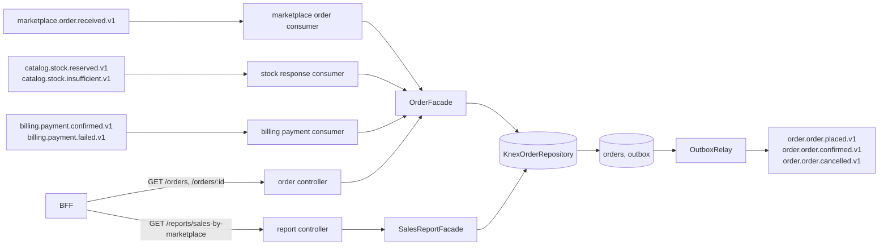

# order-service orders Design

**Spec**: `.specs/features/order-service-orders/spec.md`
**Status**: Approved (2026-10-24)

---

## Architecture Overview

The service keeps the hexagonal layout of the bootstrap and of `catalog-service`: a framework-free `core/order` with the aggregate and its ports, and adapters in `infra` (Knex repositories, Express controllers, Kafka consumers, the outbox mapper). Every state change saves the aggregate and its integration events in one transaction (ADR-0002); the relay of the bootstrap publishes them.



The three consumers use three Kafka groups and three dead letter topics, so a stuck message of one flow does not hold back another (as in the catalog).

## Code Reuse Analysis

| Component | Reused from | How |
| --- | --- | --- |
| `AggregateRoot`, `Entity`, `Id`, `DomainEvent`, domain error categories | `order-service/src/core/shared/domain` (bootstrap) | Base of `Order`, its events and its errors |
| `KnexOutboxRepository`, `OutboxRelay`, `IntegrationEventMapper` | bootstrap | `append(tx, 'Order', events)` in the repository transaction; a new mapper for the three order events |
| Consumer, dead letter and message parsing pattern | `catalog-service/src/infra/messaging/{order-stock.consumer,dead-letter}.ts` | One generic topic consumer with a handler per topic; `sendToDeadLetter` and `parseMessage` copied (same `dlq-*` headers) |
| Request validation (`validate`, `RequestValidationError`) and the 400 handling | `catalog-service/src/infra/http/{validate,error-handler}.ts` | Same shape, copied |
| Money as integer cents, bounds of an order | `billing-service/internal/core/invoice/model` | Same bounds, so what the order-service accepts the billing-service can charge |

## Components

### Order (core/order/model)

- **Purpose**: the aggregate. States `RECEIVED`, `CONFIRMED`, `PAID`, `CANCELLED`; items `{ sku, quantity, unitPriceCents }`; `totalCents`; `cancellationReason`; `orderedAt`, `updatedAt`, `version`.
- **Interfaces**: `Order.receive(input)` (validates and records `OrderPlaced`), `order.confirm(now)` → `boolean` changed (records `OrderConfirmed`), `order.cancelForStock(now)` and `order.cancelForPayment(now)` (record `OrderCancelled`), `order.markPaid(now)`, `Order.restore(snapshot)`.
- **Rules**: `confirm` is valid from `RECEIVED` (and a no-op on `CONFIRMED` or `PAID`); `cancelForStock` from `RECEIVED` (no-op when already cancelled for stock); `markPaid` from `CONFIRMED` (no-op on `PAID`); `cancelForPayment` from `CONFIRMED` (no-op when already cancelled for payment). Anything else is an `OrderStateConflictError` (a `ConflictError`, so the consumer sends it to the dead letter).
- **Validation**: 1 to 100 items, quantity 1 to 10 000, unit price 0.01 to 1 000 000.00 with at most two decimals, a non-blank SKU and external order id, a known marketplace, and a declared total equal to the sum (`InvalidOrderError`, a `ValidationError`).

### Facades (core/order)

- `OrderFacade` implements the driving ports: `receive`, `applyStockReserved`, `applyStockInsufficient`, `applyPaymentConfirmed`, `applyPaymentFailed`, `find`, `list`. It depends on `OrderRepositoryPort` only.
- `SalesReportFacade.salesByMarketplace({ from, to })` validates the period and asks `OrderRepositoryPort.salesByMarketplace`; it fills the marketplaces without sales with zeros.

### KnexOrderRepository (infra/persistence)

- `saveNew(order)`: inserts; a unique violation on (`marketplace`, `external_order_id`) throws `ConcurrentModificationError`, which the consumer rethrows so the redelivery finds the order (ORD-03). Appends the events to the outbox in the same transaction.
- `save(order)`: `update ... where id = ? and version = ?`; zero rows is a `ConcurrentModificationError`.
- `findById`, `findByExternalId`, `list(query)` and `salesByMarketplace(from, to)` (one SQL over `orders` with the lateral sum of the units in the `items` jsonb).

### Consumers (infra/messaging)

- `TopicConsumer`: connects, subscribes from the beginning, parses the CloudEvents headers (`ce_specversion`, `ce_id`, `ce_source`, `ce_type`), dispatches the value to the handler of the topic, sends `UnprocessableMessageError` and `DomainError` to the dead letter and rethrows everything else (kafkajs redelivers).
- `order-events.handlers.ts`: zod schemas of the five consumed contracts and the handlers that call the facade.

## Data Models

```sql
orders(id uuid pk, marketplace text, external_order_id text, status text, total_cents bigint,
       cancellation_reason text null, items jsonb, ordered_at timestamptz, created_at timestamptz,
       updated_at timestamptz, version int, unique (marketplace, external_order_id))
-- index on (marketplace, status, ordered_at) for the list and the report
```

Items keep `{ sku, quantity, unitPriceCents }` in the jsonb. API and events convert cents to JSON numbers (`cents / 100`, at most two decimals).

## Events published (integration mapper)

| Domain event | Topic | Data |
| --- | --- | --- |
| `OrderPlaced` | `order.order.placed.v1` | `orderId`, `marketplace`, `externalOrderId`, `items[{ sku, quantity, unitPrice }]` |
| `OrderConfirmed` | `order.order.confirmed.v1` | `orderId`, `marketplace`, `externalOrderId`, `items`, `total`, `confirmedAt` |
| `OrderCancelled` | `order.order.cancelled.v1` | `orderId`, `reason`, `marketplace`, `externalOrderId` |

## Error Handling Strategy

| Scenario | Handling |
| --- | --- |
| Message out of contract, or a domain error (invalid order, unknown order, contradicting outcome) | Dead letter of the group with `dlq-*` headers, offset committed |
| Database or Kafka failure, optimistic lock or unique conflict | The handler throws, kafkajs redelivers; the next delivery finds the first result and does nothing |
| Invalid query parameter | 400 problem+json naming each parameter |
| Unknown order | 404 problem+json |
| Anything else in HTTP | 500 without the message |

## Tech Decisions

| Decision | Choice | Rationale |
| --- | --- | --- |
| Idempotency | State of the order plus the unique marketplace and external order id | An outcome that repeats is a no-op; a table of processed events adds a second transaction boundary for no extra safety |
| Items storage | `jsonb` column | At most 100 items, always read with the order; the report sums them with one lateral query |
| Consumer code | One generic `TopicConsumer` with a handler map | Three groups with the same behavior differ only in topics, handlers and dead letter |
| Validation library | `zod`, as the catalog-service | One way to validate messages and requests across the Node services |
