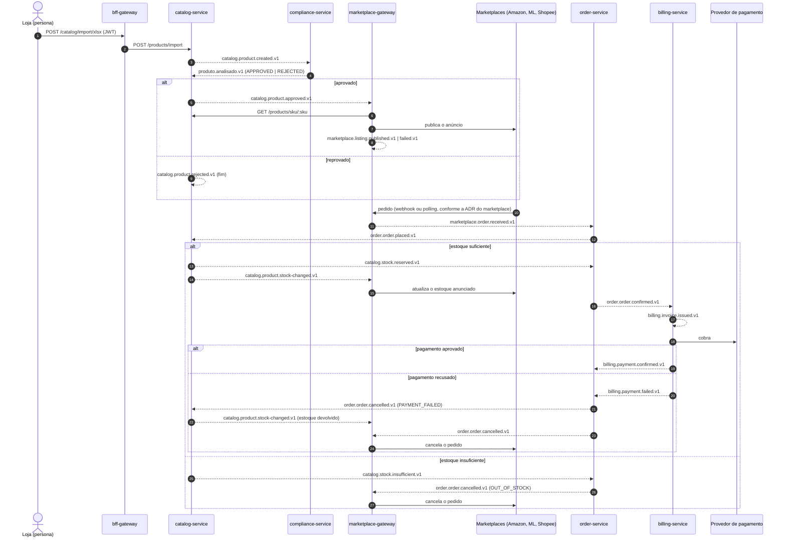

# Catálogo de eventos e contratos

Contratos de mensageria (Kafka) e das chamadas REST entre os serviços do omni-market. Este é o lugar onde um evento novo é combinado **antes** de ser implementado: primeiro entra aqui, depois no `docker/kafka/create-topics.sh` e no código.

Cada contrato tem um estado:

| Estado | Significado |
|---|---|
| **Implementado** | Existe no código da `dev`. A ficha foi tirada do código (schemas zod/pydantic e mappers) |
| **Provisório** | Um lado já existe e o outro ainda não. O contrato vale como está, e mudanças são combinadas com o dono do lado pronto |
| **Proposto** | Ainda não existe. Precisa ser aprovado pelo dono indicado antes de virar código |

## Convenções

- **Formato:** [CloudEvents 1.0](https://github.com/cloudevents/spec/blob/v1.0.2/cloudevents/bindings/kafka-protocol-binding.md) em *binary mode*. Os atributos vão nos headers `ce_*`, e o valor da mensagem é só o `data`, em JSON.
  - Headers obrigatórios: `ce_specversion=1.0`, `ce_id`, `ce_source`, `ce_type`, `ce_subject` (id do agregado), `ce_time` (ISO-8601) e `content-type=application/json`.
  - `ce_source=/<serviço>` (ex.: `/catalog-service`).
  - `ce_type` é igual ao nome do tópico.
  - `traceparent` (W3C) segue nos headers, para o trace atravessar os serviços.
- **Nome do tópico:** `<serviço>.<agregado>.<evento>.vN`, um tópico por tipo de evento. A única exceção é `produto.analisado.v1` (ver [Divergências](#divergências-conhecidas)).
- **Chave da mensagem:** o id do agregado que gerou o evento. A ordem é garantida por agregado dentro de um mesmo tópico, nunca entre tópicos diferentes.
- **Publicação:** sempre por transactional outbox ([ADR-0002](adr/0002-outbox-para-eventos-do-catalog-service.md)). O evento existe se e somente se a transação do agregado commitou.
- **Entrega:** *at-least-once*. Todo consumidor é idempotente: deduplica por `ce_id` (inbox, como a tabela `processed_events`) ou pelo estado do agregado.
- **Falhas:** uma DLQ por consumer group, chamada `<serviço consumidor>.<assunto>.dlq`, com 1 partição e retenção de 14 dias.
  - Vai para a DLQ só a mensagem que **nunca** vai ser processada: fora do contrato, ou que gera um erro de domínio.
  - Erros transitórios (banco fora, conflito de concorrência) são relançados, e o Kafka reentrega.
  - A mensagem na DLQ mantém chave, valor e headers originais, mais `dlq-original-topic`, `dlq-original-partition`, `dlq-original-offset` e `dlq-reason`.
- **Payload:** campos em camelCase. Ids são UUID em texto. Valores em dinheiro são `number` em reais, com até 2 casas decimais. Datas em ISO-8601 UTC.
- **Evolução:** adicionar campo opcional é compatível (os consumidores ignoram campos desconhecidos). Remover ou renomear campo, ou mudar o tipo, exige um tópico `vN+1`, e os dois convivem até nenhum consumidor usar o antigo.

## Visão geral dos tópicos

| Tópico | Produtor | Consumidores | Chave | Estado |
|---|---|---|---|---|
| [`catalog.product.created.v1`](#catalogproductcreatedv1) | catalog-service | compliance-service | `productId` | Implementado |
| [`produto.analisado.v1`](#produtoanalisadov1) | compliance-service | catalog-service | `productId` | Implementado |
| [`catalog.product.approved.v1`](#catalogproductapprovedv1) | catalog-service | marketplace-gateway (#21) | `productId` | Provisório |
| [`catalog.product.rejected.v1`](#catalogproductrejectedv1) | catalog-service | nenhum | `productId` | Implementado |
| [`catalog.product.stock-changed.v1`](#catalogproductstock-changedv1) | catalog-service | marketplace-gateway (#33) | `productId` | Implementado |
| [`catalog.product.price-changed.v1`](#catalogproductprice-changedv1) | catalog-service | marketplace-gateway (#33) | `productId` | Implementado |
| [`catalog.stock.reserved.v1`](#catalogstockreservedv1) | catalog-service | order-service (#20, #29) | `orderId` | Implementado |
| [`catalog.stock.insufficient.v1`](#catalogstockinsufficientv1) | catalog-service | order-service (#20, #29) | `orderId` | Implementado |
| [`order.order.placed.v1`](#orderorderplacedv1) | order-service (#20) | catalog-service | `orderId` | Implementado |
| [`order.order.confirmed.v1`](#orderorderconfirmedv1) | order-service (#20) | billing-service (#23) | `orderId` | Implementado |
| [`order.order.cancelled.v1`](#orderordercancelledv1) | order-service (#20) | catalog-service, marketplace-gateway, billing-service (#23) | `orderId` | Implementado |
| [`marketplace.order.received.v1`](#marketplaceorderreceivedv1) | marketplace-gateway (#22) | order-service (#20) | `<marketplace>:<externalOrderId>` | Implementado |
| [`marketplace.listing.published.v1`](#marketplacelistingpublishedv1-e-marketplacelistingfailedv1) | marketplace-gateway (#21) | nenhum (consulta pela API, #35) | `productId` | Proposto |
| [`marketplace.listing.failed.v1`](#marketplacelistingpublishedv1-e-marketplacelistingfailedv1) | marketplace-gateway (#21) | nenhum (consulta pela API, #35) | `productId` | Proposto |
| [`billing.invoice.issued.v1`](#billinginvoiceissuedv1) | billing-service (#23) | nenhum | `invoiceId` | Proposto |
| [`billing.payment.confirmed.v1`](#billingpaymentconfirmedv1-e-billingpaymentfailedv1) | billing-service (#32) | order-service | `invoiceId` | Implementado |
| [`billing.payment.failed.v1`](#billingpaymentconfirmedv1-e-billingpaymentfailedv1) | billing-service (#32) | order-service | `invoiceId` | Implementado |

DLQs: ver [Dead letter topics](#dead-letter-topics).

## Fluxo principal



Setas tracejadas são eventos no Kafka; setas contínuas são chamadas síncronas. O trecho a partir do pedido segue a [ADR-0004](adr/0004-catalog-dono-do-estoque-com-reserva-por-coreografia.md). O trecho de cobrança segue a ADR-0005 (escopo da cobrança, PR #51).

---

## Contratos implementados e provisórios

### `catalog.product.created.v1`

**Estado:** Implementado · **Produtor:** catalog-service · **Consumidor:** compliance-service (group `compliance-service`, DLQ `compliance.product-created.dlq`)

Publicado uma vez por produto criado, tanto em `POST /products` quanto em cada item de `POST /products/import`. O produto nasce com análise `PENDING`.

| Campo | Tipo | Regra |
|---|---|---|
| `productId` | string (UUID) | id do produto no catalog |
| `sku` | string | maiúsculas, `^[A-Z0-9][A-Z0-9-]{2,49}$` |
| `name` | string | não vazio |
| `description` | string | não vazio |
| `price` | number | ≥ 0, em reais |
| `stock` | integer | ≥ 0, estoque inicial |

```json
{
  "productId": "0b8f2c1e-6a4d-4d1e-9a51-3f0f1b2c7d10",
  "sku": "NB-001",
  "name": "Notebook",
  "description": "Notebook 16GB RAM",
  "price": 4500,
  "stock": 2
}
```

O consumidor exige os headers `ce_specversion`, `ce_id`, `ce_source` e `ce_type`. Mensagem sem eles, com `ce_type` diferente ou com dados inválidos vai para a DLQ. A deduplicação é por `ce_id` (`processed_events`).

### `produto.analisado.v1`

**Estado:** Implementado · **Produtor:** compliance-service · **Consumidor:** catalog-service (group `catalog-service-group`, DLQ `catalog.product-analysis.dlq`)

Resultado da cadeia de regras de conformidade: termos proibidos (bloqueante), teto de preço (100.000) e descrição mínima (20 caracteres).

| Campo | Tipo | Regra |
|---|---|---|
| `sku` | string | SKU do produto analisado (o catalog localiza o produto por ele) |
| `status` | `"APPROVED"` \| `"REJECTED"` | `REJECTED` quando há pelo menos uma violação |
| `violations` | array de `{ ruleCode, message }` | vazio quando aprovado. O catalog ignora este campo hoje |

```json
{
  "sku": "NB-002",
  "status": "REJECTED",
  "violations": [
    { "ruleCode": "PROHIBITED_TERMS", "message": "Name or description contains prohibited terms: replica." }
  ]
}
```

- A chave e o `ce_subject` são o `productId`.
- No catalog:
  - repetir o mesmo resultado não tem efeito;
  - um resultado que inverte uma análise já concluída é um conflito e vai para a DLQ;
  - um SKU desconhecido também vai para a DLQ.

### `catalog.product.approved.v1`

**Estado:** Provisório (publicado, sem consumidor) · **Produtor:** catalog-service · **Consumidor previsto:** marketplace-gateway (#21)

Publicado uma vez, quando a análise passa de `PENDING` para `APPROVED`. A partir daí o produto pode ser anunciado e vendido.

| Campo | Tipo |
|---|---|
| `productId` | string (UUID) |
| `sku` | string |

```json
{ "productId": "0b8f2c1e-6a4d-4d1e-9a51-3f0f1b2c7d10", "sku": "NB-001" }
```

O evento não traz nome, preço nem estoque. O marketplace-gateway busca esses dados em `GET /products/sku/:sku` ou mantém uma projeção a partir de `catalog.product.created.v1`; a escolha é da ADR #12.

### `catalog.product.rejected.v1`

**Estado:** Implementado (sem consumidor) · **Produtor:** catalog-service

Publicado uma vez, quando a análise passa de `PENDING` para `REJECTED`. Tem o mesmo payload do `approved`. Não há consumidor previsto. O evento fica disponível para auditoria (persona Fiscal) e para relatórios.

### `catalog.product.stock-changed.v1`

**Estado:** Implementado · **Produtor:** catalog-service · **Consumidor:** marketplace-gateway (#33)

Publicado sempre que o estoque de um produto muda por reserva ou devolução, na mesma transação da reserva.

| Campo | Tipo | Regra |
|---|---|---|
| `productId` | string (UUID) | |
| `sku` | string | |
| `stock` | integer | valor **absoluto** depois da mudança, não um delta |

```json
{ "productId": "0b8f2c1e-6a4d-4d1e-9a51-3f0f1b2c7d10", "sku": "NB-001", "stock": 0 }
```

Como o valor é absoluto, um consumidor que receba eventos repetidos converge para o último valor aplicado. Com `stock: 0`, o marketplace-gateway zera a disponibilidade do anúncio.

### `catalog.product.price-changed.v1`

**Estado:** Implementado · **Produtor:** catalog-service · **Consumidor:** marketplace-gateway (#33)

Publicado quando `PATCH /products/sku/:sku/price` altera o preço de um produto existente, na mesma transação que grava o novo valor.

| Campo | Tipo | Regra |
|---|---|---|
| `productId` | string (UUID) | |
| `sku` | string | |
| `price` | number | valor **absoluto** em reais, maior ou igual a 0 |

```json
{ "productId": "0b8f2c1e-6a4d-4d1e-9a51-3f0f1b2c7d10", "sku": "NB-001", "price": 4999.9 }
```

- A rota responde `204` e exige `{ "price": <number> }`; preço inválido responde `422`.
- Repetir o preço vigente, ou alterar um SKU desconhecido, não gera evento.
- O preço é absoluto, então o consumidor que receba eventos repetidos converge para o último valor aplicado.

### `order.order.placed.v1`

**Estado:** Implementado · **Produtor:** order-service · **Consumidor:** catalog-service (group `catalog-service-order-stock`, DLQ `catalog.order-stock.dlq`)

Publicado quando o order-service persiste um pedido novo. Pede a reserva do estoque.

| Campo | Tipo | Regra | Estado |
|---|---|---|---|
| `orderId` | string (UUID) | obrigatório | Provisório |
| `items` | array, mín. 1 | obrigatório | Provisório |
| `items[].sku` | string | não vazio | Provisório |
| `items[].quantity` | integer | > 0 | Provisório |
| `items[].unitPrice` | number | preço unitário de venda | Proposto (opcional) |
| `marketplace` | `"AMAZON"` \| `"MERCADO_LIVRE"` \| `"SHOPEE"` | origem do pedido | Proposto (opcional) |
| `externalOrderId` | string | id do pedido no marketplace | Proposto (opcional) |

```json
{
  "orderId": "6f1c2b8e-0000-4000-8000-000000000001",
  "marketplace": "MERCADO_LIVRE",
  "externalOrderId": "ML-2000001",
  "items": [{ "sku": "NB-001", "quantity": 1, "unitPrice": 4500 }]
}
```

- Os campos propostos são opcionais porque o catalog ignora campos desconhecidos. Incluí-los não quebra o consumidor atual e ajuda nos traces e nos relatórios.
- Regras no catalog (#30):
  - O pedido é reservado inteiro ou não é reservado.
  - Linhas do mesmo SKU são somadas, e `nb-001` e `NB-001` são o mesmo SKU.
  - SKU desconhecido, não aprovado ou malformado conta como `available: 0`, então o pedido sempre recebe uma resposta.
  - Idempotência por `orderId`: repetir o evento não muda nada.
  - Mensagem fora do contrato (JSON inválido, `orderId` que não é UUID, `items` vazio, `quantity` ≤ 0) vai para a DLQ.

### `order.order.cancelled.v1`

**Estado:** Implementado · **Produtor:** order-service · **Consumidores:** catalog-service (devolve o estoque), marketplace-gateway (cancela no marketplace) e billing-service (cancela a fatura que ainda não foi paga, #23)

| Campo | Tipo | Regra | Estado |
|---|---|---|---|
| `orderId` | string (UUID) | obrigatório | Provisório |
| `reason` | string | `OUT_OF_STOCK` \| `PAYMENT_FAILED` \| `MARKETPLACE_CANCELLED` | Provisório (opcional; valores propostos) |
| `marketplace` | string | como no `placed` | Proposto (obrigatório para o cancelamento chegar ao marketplace) |
| `externalOrderId` | string | como no `placed` | Proposto (obrigatório para o cancelamento chegar ao marketplace) |

```json
{
  "orderId": "6f1c2b8e-0000-4000-8000-000000000001",
  "reason": "PAYMENT_FAILED",
  "marketplace": "MERCADO_LIVRE",
  "externalOrderId": "ML-2000001"
}
```

- `OUT_OF_STOCK` vem da resposta `insufficient` (ADR-0004). `PAYMENT_FAILED` vem do billing. `MARKETPLACE_CANCELLED` é o cancelamento feito pelo comprador no marketplace, que depende da #22.
- O marketplace-gateway precisa de `marketplace` e `externalOrderId` para cancelar no marketplace certo; por isso o order-service deve incluí-los sempre, e o gateway manda o cancelamento que chegar sem eles para a DLQ `marketplace.order-cancelled.dlq` (como o PR #63 implementa). O catalog e o billing não usam esses dois campos.
- No catalog:
  - só uma reserva ainda `RESERVED` devolve estoque, e repetir o cancelamento não muda nada;
  - um cancelamento que chega antes do `placed` grava um tombstone, e o `placed` que chegar depois é ignorado.
- No billing (group `billing-service`, DLQ `billing.order-events.dlq`):
  - cancela a fatura `ISSUED` ou `PAYMENT_PENDING`; uma fatura `PAID`, `PAYMENT_FAILED` ou `CANCELLED` não muda, porque não há estorno;
  - um cancelamento que chega antes do `confirmed` fica registrado, e o `confirmed` que chegar depois não gera fatura.

### `catalog.stock.reserved.v1`

**Estado:** Implementado · **Produtor:** catalog-service · **Consumidor:** order-service (group `order-service-stock-response`, DLQ `order.stock-response.dlq`)

O estoque de todos os itens do pedido foi baixado. Com ele, o order-service confirma o pedido e publica `order.order.confirmed.v1`.

| Campo | Tipo | Regra |
|---|---|---|
| `orderId` | string (UUID) | |
| `items` | array de `{ sku, quantity }` | SKUs em maiúsculas, linhas repetidas somadas |

```json
{ "orderId": "6f1c2b8e-0000-4000-8000-000000000001", "items": [{ "sku": "NB-001", "quantity": 1 }] }
```

### `catalog.stock.insufficient.v1`

**Estado:** Implementado · **Produtor:** catalog-service · **Consumidor:** order-service (group `order-service-stock-response`, DLQ `order.stock-response.dlq`)

Algum item não tinha estoque, e nada foi baixado. O order-service cancela o pedido com `reason: OUT_OF_STOCK`.

| Campo | Tipo | Regra |
|---|---|---|
| `orderId` | string (UUID) | |
| `items` | array de `{ sku, requested, available }` | todos os itens que faltam, não só o primeiro |

```json
{
  "orderId": "6f1c2b8e-0000-4000-8000-000000000002",
  "items": [{ "sku": "NB-001", "requested": 2, "available": 1 }]
}
```

No order-service, as duas respostas seguem as mesmas regras:

- `ce_source` é `/catalog-service` e `ce_subject` é o `orderId`.
- A mesma resposta repetida não muda nada.
- Uma resposta que contradiz o pedido (ex.: `insufficient` para um pedido `CONFIRMED`) ou que cita um pedido desconhecido vira `warn` e é ignorada, sem DLQ.
- Só a mensagem fora do contrato vai para `order.stock-response.dlq`.

---

## Contratos propostos

Precisam da aprovação do dono indicado. Os nomes de campo seguem as convenções acima. Os detalhes que dependem de uma ADR ainda aberta estão marcados.

### `marketplace.order.received.v1`

**Estado:** Implementado · **Produtor:** marketplace-gateway (#22) · **Consumidor:** order-service (#20) · **Origem:** ADR #12 (webhook ou polling)

Pedido recebido de um marketplace, já traduzido para o formato canônico pela anti-corruption layer do marketplace-gateway.

| Campo | Tipo | Regra |
|---|---|---|
| `marketplace` | `"AMAZON"` \| `"MERCADO_LIVRE"` \| `"SHOPEE"` | |
| `externalOrderId` | string | id do pedido no marketplace |
| `items` | array, de 1 a 100, de `{ sku, quantity, unitPrice }` | `sku` do catálogo (1 a 64 caracteres), `quantity` de 1 a 10.000, `unitPrice` de R$ 0,01 a R$ 1.000.000,00 |
| `total` | number | total informado; o order-service recalcula pelos itens e registra divergência |
| `orderedAt` | string (ISO-8601) | data do pedido no marketplace |

```json
{
  "marketplace": "MERCADO_LIVRE",
  "externalOrderId": "ML-2000001",
  "items": [{ "sku": "NB-001", "quantity": 1, "unitPrice": 4500 }],
  "total": 4500,
  "orderedAt": "2026-10-28T13:05:00Z"
}
```

- **Chave e `ce_subject`:** `<marketplace>:<externalOrderId>` (ex.: `MERCADO_LIVRE:ML-2000001`). O pedido ainda não tem id interno nesse ponto, e é por essa dupla que o order-service garante a idempotência pedida na #20.
- **Deduplicação dupla:**
  - o marketplace-gateway não publica o mesmo pedido duas vezes (#22);
  - o order-service ignora um `marketplace + externalOrderId` que já existe, mesmo vindo com outro `ce_id`.
- **DLQ do consumidor:** `order.marketplace-order.dlq`.
- O `ce_id` idempotente é gravado na inbox na mesma transação do pedido e do evento `order.order.placed.v1`. Mensagens inválidas vão para a DLQ; falhas de infraestrutura são reentregues.
- **Em aberto:** dados do comprador e do frete ficam fora até algum serviço precisar deles.

### `order.order.confirmed.v1`

**Estado:** Implementado · **Produtor:** order-service (#20, #29) · **Consumidor:** billing-service (#23) · **Origem:** ADR-0004

O estoque do pedido foi reservado (`catalog.stock.reserved.v1`), então o pedido está confirmado. É o gatilho da cobrança: o billing só cobra a partir dele.

| Campo | Tipo | Regra |
|---|---|---|
| `orderId` | string (UUID) | |
| `marketplace` | string | como no `placed` |
| `externalOrderId` | string | como no `placed` |
| `items` | array de `{ sku, quantity, unitPrice }` | |
| `total` | number | soma de `quantity × unitPrice` |
| `confirmedAt` | string (ISO-8601) | |

```json
{
  "orderId": "6f1c2b8e-0000-4000-8000-000000000001",
  "marketplace": "MERCADO_LIVRE",
  "externalOrderId": "ML-2000001",
  "items": [{ "sku": "NB-001", "quantity": 1, "unitPrice": 4500 }],
  "total": 4500,
  "confirmedAt": "2026-10-28T13:05:02Z"
}
```

O billing deduplica por `ce_id` (inbox) e por `orderId`, já que um pedido gera exatamente uma fatura (#23). DLQ do consumidor: `billing.order-events.dlq`, a mesma do `order.order.cancelled.v1`, porque o billing lê os dois tópicos com um consumer group só.

O billing recalcula o total pelos itens. Vai para a DLQ a mensagem com `marketplace` desconhecido, com `total` diferente da soma de `quantity × unitPrice`, ou fora destes limites: de 1 a 100 itens, `quantity` de 1 a 10 000 e `unitPrice` de 0.01 a 1 000 000.00. Não há campo de moeda: todos os valores são em reais (BRL).

### `marketplace.listing.published.v1` e `marketplace.listing.failed.v1`

**Estado:** Proposto · **A aprovar:** @diegodiogenes (#21) · **Depende de:** ADR #12

Resultado da publicação de um produto aprovado em **um** marketplace. Um produto gera um evento por marketplace.

| Campo | Tipo | Evento |
|---|---|---|
| `productId` | string (UUID) | ambos |
| `sku` | string | ambos |
| `marketplace` | string | ambos |
| `externalListingId` | string | `published` |
| `publishedAt` | string (ISO-8601) | `published` |
| `reason` | string | `failed`: mensagem da última tentativa (ex.: `HTTP 503`) |
| `attempts` | integer | `failed`: chamadas feitas ao marketplace antes de desistir; uma recusa conta 1 e o circuito aberto conta 0 |

```json
{ "productId": "0b8f2c1e-6a4d-4d1e-9a51-3f0f1b2c7d10", "sku": "NB-001", "marketplace": "SHOPEE", "reason": "HTTP 503", "attempts": 3 }
```

Ainda não há consumidor: o status dos anúncios é consultado pela API do marketplace-gateway (#35). Os eventos ficam para auditoria e para o dashboard (#36).

### `billing.invoice.issued.v1`

**Estado:** Proposto · **Produtor:** billing-service (#23), que aprova esta ficha · **Origem:** ADR-0005 (escopo da cobrança, PR #51)

Publicado quando a fatura nasce de um `order.order.confirmed.v1`. O `amount` é o total cobrado do pedido. A comissão do Omni Market vem da taxa do marketplace (Amazon 12%, Mercado Livre 11% e Shopee 14%, configuráveis), e o `netAmount` é o que cabe à loja.

| Campo | Tipo | Regra |
|---|---|---|
| `invoiceId` | string (UUID) | |
| `orderId` | string (UUID) | |
| `externalOrderId` | string | opcional; id do pedido no marketplace |
| `marketplace` | string | como no `confirmed` |
| `amount` | number | total do pedido |
| `commissionPercent` | number | taxa aplicada, ex.: `11.00` |
| `commissionAmount` | number | `amount × taxa`, arredondado para cima no centavo (half-up) |
| `netAmount` | number | `amount − commissionAmount` |
| `issuedAt` | string (ISO-8601) | |

```json
{
  "invoiceId": "a3c1d5e2-7b4f-4c8a-9e10-2d3f4a5b6c7d",
  "orderId": "6f1c2b8e-0000-4000-8000-000000000001",
  "externalOrderId": "ML-2000001",
  "marketplace": "MERCADO_LIVRE",
  "amount": 15000.00,
  "commissionPercent": 11.00,
  "commissionAmount": 1650.00,
  "netAmount": 13350.00,
  "issuedAt": "2026-10-28T13:05:03Z"
}
```

Ainda não há consumidor: a fatura é consultada pela API do billing (#34).

### `billing.payment.confirmed.v1` e `billing.payment.failed.v1`

**Estado:** Implementado · **Produtor:** billing-service (#32) · **Consumidor:** order-service (#29, group `order-service-billing-payment`) · **Origem:** ADR-0005 e [contrato do PSP simulado](#contrato-do-psp-simulado)

| Campo | Tipo | Evento |
|---|---|---|
| `invoiceId` | string (UUID) | ambos |
| `orderId` | string (UUID) | ambos |
| `amount` | number | ambos |
| `pspTransactionId` | string | `confirmed`: id da cobrança no PSP; `failed`: o mesmo id, ausente quando o PSP recusou ao criar a cobrança (`422`) |
| `paidAt` | string (ISO-8601) | `confirmed` |
| `reason` | string | `failed`: código devolvido pelo PSP (ex.: `INSUFFICIENT_FUNDS`, `AMOUNT_NOT_ALLOWED`) |
| `failedAt` | string (ISO-8601) | `failed` |

```json
{
  "invoiceId": "a3c1d5e2-7b4f-4c8a-9e10-2d3f4a5b6c7d",
  "orderId": "6f1c2b8e-0000-4000-8000-000000000001",
  "amount": 15000.00,
  "pspTransactionId": "ch_paid_a3c1d5e2-7b4f-4c8a-9e10-2d3f4a5b6c7d",
  "paidAt": "2026-10-28T13:05:06Z"
}
```

```json
{
  "invoiceId": "7c4d1e90-2b7f-4f0e-9a3c-51c0f4d8e6a2",
  "orderId": "6f1c2b8e-0000-4000-8000-000000000002",
  "amount": 105000.00,
  "pspTransactionId": "ch_failed_7c4d1e90-2b7f-4f0e-9a3c-51c0f4d8e6a2",
  "reason": "INSUFFICIENT_FUNDS",
  "failedAt": "2026-10-28T13:10:06Z"
}
```

- O billing publica `confirmed` ao receber o webhook `PAID`, e `failed` ao receber `FAILED` ou um `422` do PSP. Indisponibilidade do PSP (timeout, `5xx`, circuito aberto) não falha a fatura: o billing tenta de novo com espera crescente.
- Com `failed`, o order-service cancela o pedido com `reason: PAYMENT_FAILED`. O catalog devolve o estoque, e o marketplace-gateway cancela no marketplace (ADR-0004).
- Com `confirmed`, o order-service marca o pedido como `PAID`.
- No order-service, `ce_source` é `/billing-service` e `ce_subject` é o `invoiceId`. Um resultado para um pedido que não está `CONFIRMED` (ou que já tem esse resultado) não muda nada; a contradição vira `warn`, sem DLQ.
- DLQ do consumidor no order: `order.billing-payment.dlq`.

---

## Dead letter topics

| DLQ | Consumer group | Tópicos de origem | Estado |
|---|---|---|---|
| `compliance.product-created.dlq` | `compliance-service` | `catalog.product.created.v1` | Implementado |
| `catalog.product-analysis.dlq` | `catalog-service-group` | `produto.analisado.v1` | Implementado |
| `catalog.order-stock.dlq` | `catalog-service-order-stock` | `order.order.placed.v1`, `order.order.cancelled.v1` | Implementado |
| `order.marketplace-order.dlq` | `order-service-marketplace-orders` | `marketplace.order.received.v1` | Implementado |
| `order.stock-response.dlq` | `order-service-stock-response` | `catalog.stock.reserved.v1`, `catalog.stock.insufficient.v1` | Implementado |
| `order.billing-payment.dlq` | `order-service-billing-payment` | `billing.payment.confirmed.v1`, `billing.payment.failed.v1` | Implementado |
| `marketplace.catalog-product.dlq` | marketplace-gateway | `catalog.product.approved.v1`, `catalog.product.stock-changed.v1`, `catalog.product.price-changed.v1` | Implementado |
| `marketplace.order-cancelled.dlq` | marketplace-gateway | `order.order.cancelled.v1` | Proposto |
| `billing.order-events.dlq` | `billing-service` | `order.order.confirmed.v1`, `order.order.cancelled.v1` | Proposto |

Os nomes das DLQs propostas seguem o padrão das existentes. Se um serviço novo usar um consumer group por tópico, ele terá uma DLQ por tópico.

## Chamadas REST entre serviços

Os serviços internos não validam token: a autenticação e a autorização por papel ficam no BFF (Keycloak). O BFF repassa o usuário autenticado no header `X-User-Id`.

| Origem | Destino | Chamada | Uso | Estado |
|---|---|---|---|---|
| bff-gateway | catalog-service | `POST /products/import` com `{ items: [{ sku, name, description, price, stock }] }` (1 a 1000 itens) | importação da planilha (`POST /catalog/import/xlsx` no BFF) | Implementado |
| bff-gateway, marketplace-gateway | catalog-service | `GET /products/sku/:sku` → `{ id, sku, name, description, price, stock, analysisStatus }` | consulta do produto e dos dados para o anúncio | Implementado (o uso pelo marketplace depende da ADR #12) |
| bff-gateway | order-service | listar e detalhar pedidos, relatórios por marketplace | #24, #31 | Proposto |
| bff-gateway | billing-service | `GET /invoices` (filtros `orderId`, `status`, `marketplace`, `limit`, `offset`) e `GET /invoices/{id}` | #34 | Proposto |
| bff-gateway | marketplace-gateway | status dos anúncios por marketplace | #35 | Proposto |
| marketplace-gateway | marketplaces (WireMock) | publicar anúncio, atualizar estoque, receber e cancelar pedidos | #18, #21, #22, #33 | Proposto (ADR #12) |
| billing-service | PSP (WireMock) | `POST /psp/v1/charges` e `GET /psp/v1/charges/{id}`; o PSP chama de volta `POST /webhooks/psp` | #26, #32 | Proposto ([contrato do PSP](#contrato-do-psp-simulado)) |

O catalog responde erros em `application/problem+json`: 422 para validação, 404 para não encontrado e 409 para conflito (ex.: SKU repetido na importação).

## Contrato do PSP (simulado)

O billing cobra de forma assíncrona: pede a cobrança e recebe o resultado por webhook, com a consulta de status como reserva. No ambiente local o PSP é o WireMock (`http://wiremock:8080` na rede do compose, `http://localhost:8089` na máquina). Os mappings entram no PR da #32, que cobre o que a #26 pede.

**Criar a cobrança**

```http
POST /psp/v1/charges
Content-Type: application/json
Idempotency-Key: a3c1d5e2-7b4f-4c8a-9e10-2d3f4a5b6c7d

{
  "reference": "a3c1d5e2-7b4f-4c8a-9e10-2d3f4a5b6c7d",
  "amount": 1500000,
  "currency": "BRL",
  "description": "Pedido 6f1c2b8e-0000-4000-8000-000000000001 (MERCADO_LIVRE)",
  "callbackUrl": "http://billing-service:8086/webhooks/psp"
}
```

`Idempotency-Key` e `reference` são o `invoiceId`: repetir a chamada não cria outra cobrança. O `amount` vai em centavos.

```http
201 Created
{ "id": "ch_paid_a3c1d5e2-7b4f-4c8a-9e10-2d3f4a5b6c7d", "reference": "a3c1d5e2-7b4f-4c8a-9e10-2d3f4a5b6c7d", "status": "PENDING" }

422 Unprocessable Entity
{ "code": "AMOUNT_NOT_ALLOWED" }
```

O `201` aceita a cobrança e o resultado chega pelo webhook. O `422` é uma recusa na criação: o billing marca a fatura como `PAYMENT_FAILED`. Timeout (3 s), falha de conexão, `429` e `5xx` contam como indisponibilidade: até 3 tentativas com espera crescente, e circuit breaker.

**Webhook de resultado**

```http
POST /webhooks/psp
Content-Type: application/json
X-PSP-Token: <token compartilhado>

{
  "chargeId": "ch_failed_7c4d1e90-2b7f-4f0e-9a3c-51c0f4d8e6a2",
  "reference": "7c4d1e90-2b7f-4f0e-9a3c-51c0f4d8e6a2",
  "status": "FAILED",
  "failureReason": "INSUFFICIENT_FUNDS",
  "occurredAt": "2026-10-28T13:10:06Z"
}
```

`status` é `PAID` ou `FAILED`, e `failureReason` é `null` quando pago.

| Resposta do billing | Quando |
|---|---|
| `204` | resultado aplicado, ou o mesmo resultado repetido |
| `400` | corpo inválido |
| `401` | `X-PSP-Token` ausente ou errado |
| `404` | `reference` desconhecida |
| `409` | resultado contradiz o estado final da fatura ou o `chargeId` já guardado |

**Consultar a cobrança** (conciliação, para fatura `PAYMENT_PENDING` há mais de 60 s)

```http
GET /psp/v1/charges/ch_paid_a3c1d5e2-7b4f-4c8a-9e10-2d3f4a5b6c7d

200 OK
{ "id": "ch_paid_a3c1d5e2-7b4f-4c8a-9e10-2d3f4a5b6c7d", "reference": "a3c1d5e2-7b4f-4c8a-9e10-2d3f4a5b6c7d", "status": "PAID", "failureReason": null }
```

**Comportamento do simulador**

- Cobrança de R$ 100.000,00 ou mais (`amount` ≥ 10 000 000): responde `201` e, 2 s depois, chama o webhook com `FAILED` e `INSUFFICIENT_FUNDS`. Abaixo disso, chama com `PAID`.
- O simulador não guarda estado: o resultado vai codificado no id da cobrança (`ch_paid_…` ou `ch_failed_…`), que o billing trata como opaco e a consulta de status lê.
- Na demo, 1 iPhone (R$ 15.000,00) é aprovado e 7 iPhones (R$ 105.000,00) são recusados.

## Divergências conhecidas

| # | Divergência | Impacto | Sugestão |
|---|---|---|---|
| 1 | O compliance publica com `ce_source=compliance-service`. Os outros serviços usam `/catalog-service` e `/order-service` | Só cosmético hoje; filtros por `ce_source` precisam tratar os dois formatos | Trocar para `/compliance-service` (follow-up do compliance) |
| 2 | O compliance gera um `ce_id` novo a cada publicação de `produto.analisado.v1`, então uma reanálise reentregue sai com outro id | Um consumidor que deduplique só por `ce_id` processaria duas vezes. O catalog não sofre, porque é idempotente pelo estado do produto | Derivar o `ce_id` do evento de entrada (ex.: UUIDv5 do `ce_id` consumido), ou gravar o resultado e publicá-lo via outbox |
| 3 | `produto.analisado.v1` foge do padrão de nome (português, sem o serviço) | Só de convenção | Manter até a entrega. Se mudar, publicar `compliance.product.analyzed.v1` em paralelo e migrar o catalog |
| 4 | `catalog.product.rejected.v1` não tem consumidor | Nenhum | Manter para auditoria (Fiscal) e relatórios |

## Tópicos novos para o `create-topics.sh` (#14)

Já estão no script todos os tópicos **implementados**, inclusive `order.order.placed.v1` e `order.order.cancelled.v1`. Os tópicos abaixo entram quando os contratos forem aprovados, pela #14 (@zeciola) ou no PR do serviço que os usar:

```sh
# order-service
create order.order.confirmed.v1 3
create order.marketplace-order.dlq 1 retention.ms=1209600000 # 14 days to inspect and replay
create order.stock-response.dlq 1 retention.ms=1209600000 # 14 days to inspect and replay
create order.billing-payment.dlq 1 retention.ms=1209600000 # 14 days to inspect and replay

# marketplace-gateway
create marketplace.order.received.v1 3
create marketplace.listing.published.v1 3
create marketplace.listing.failed.v1 3
create marketplace.catalog-product.dlq 1 retention.ms=1209600000 # 14 days to inspect and replay
create marketplace.order-cancelled.dlq 1 retention.ms=1209600000 # 14 days to inspect and replay

# billing-service
create billing.invoice.issued.v1 3
create billing.payment.confirmed.v1 3
create billing.payment.failed.v1 3
create billing.order-events.dlq 1 retention.ms=1209600000 # 14 days to inspect and replay
```

## Como adicionar ou mudar um evento

1. Abrir um PR alterando este arquivo, com a ficha do evento no estado **Proposto**, e marcar os donos do produtor e dos consumidores.
2. Com a aprovação, adicionar o tópico (e a DLQ do consumidor) em `docker/kafka/create-topics.sh`.
3. No produtor: domain event, mapeamento para o evento de integração (`infra/messaging/<agregado>.integration-events.ts` nos serviços Node) e publicação via outbox.
4. No consumidor: validar o payload (zod/pydantic) no adapter, deduplicar e mandar para a DLQ o que nunca vai ser processado.
5. Quando o código entrar na `dev`, mudar o estado da ficha para **Implementado** (ou **Provisório**, se só um lado existir).
